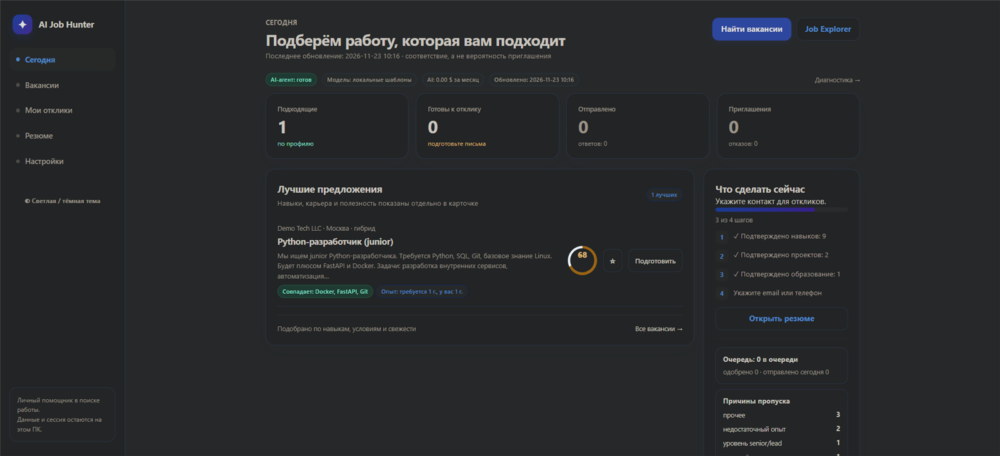
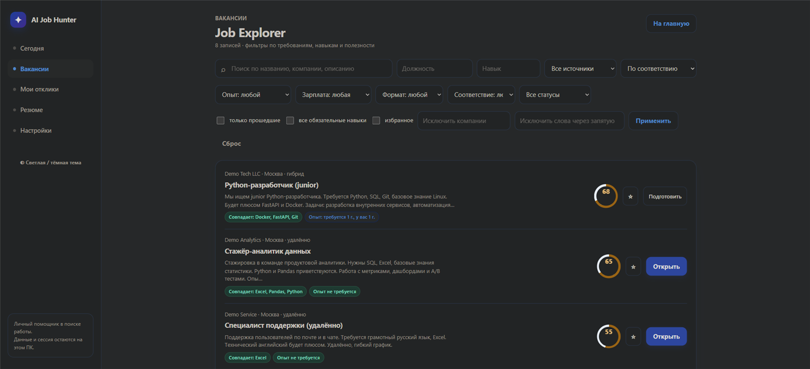
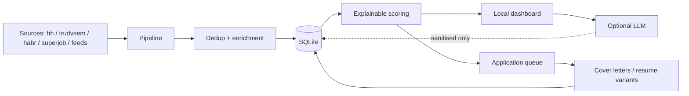

# AI Job Hunter

**A local-first job-search assistant: collect vacancies, explain the match, prepare a tailored application, and track the funnel.**

AI Job Hunter runs entirely on your machine. It pulls vacancies from public sources, deduplicates and ranks them against your confirmed profile, drafts cover letters, keeps an application queue and records outcomes. Resume text, browser sessions and messages stay local; LLM calls are optional and only receive sanitised context.



> The screenshots use synthetic demo vacancies (`jobhunter.py demo`). No real job history or personal contacts are included.

## Features

- **Multi-source collection** — official APIs and public feeds: hh.ru API, «Работа России» (trudvsem), Habr Career, SuperJob, VK Career, MTS, T-Bank, ATS pages, Telegram public channels and generic feeds. Each source can be enabled and rate-limited independently.
- **Explainable ranking** — skills, experience, career fit and usefulness are scored separately; every card shows why it matched. Calibration uses a chronological split and rejects synthetic labels.
- **Resume memory** — import PDF/DOCX/TXT, extract facts, confirm them, keep several resume variants and generate DOCX exports.
- **Letters and queue** — per-vacancy cover letters, a daily application budget, diversity-aware queue building, CSV export.
- **Job Explorer** — search, filters, favourites, exclusion lists and a match score on every vacancy.
- **Web dashboard** — local React UI served by a small Python HTTP server, no cloud account required.
- **Optional AI** — local Qwen via Ollama or any OpenAI-compatible provider. Without a key the app runs on deterministic templates.
- **Privacy guards** — contacts are stripped before LLM prompts; browser profiles, cookies, resumes and messages are never sent to providers.



## Stack

- Python 3.12+ standard library, SQLite (FTS5 for memory/search)
- `http.server`-based local dashboard
- React 18 + TypeScript + Vite + Tailwind + Radix UI
- Optional: Playwright (browser automation), python-docx, pypdf, Qwen/Ollama/OpenAI-compatible APIs

## Architecture



- `core/` — sources, pipeline, dedup, scoring, resume memory, letters, queue, DB
- `web/` — local HTTP server and JSON API
- `frontend/` — React dashboard
- `tests/` — focused unit and demo fixtures

## Quick start

```bash
git clone https://github.com/Leis4/ai-job-hunter.git
cd ai-job-hunter
python -m pip install -r requirements.txt
cp .env.example .env

# load synthetic demo vacancies (safe, no network)
python jobhunter.py demo

# build the dashboard once
cd frontend && npm install && npm run build && cd ..

python jobhunter.py serve
```

Open <http://127.0.0.1:8765/>.

Useful commands:

```bash
python jobhunter.py collect --source trudvsem
python jobhunter.py cycle
python jobhunter.py queue list
python jobhunter.py resume import path/to/resume.pdf
```

## Configuration

- `config/profile.json` — confirmed skills, experience and constraints (created by onboarding)
- `config/settings.json` — source toggles, limits, scoring weights
- `config/resume.json` — resume facts and variants

Secrets come from `.env` or the OS key store:

| Variable | Purpose |
|---|---|
| `JOB_HUNTER_API_BASE` | OpenAI-compatible endpoint (optional) |
| `JOB_HUNTER_API_KEY` | Provider key (optional) |
| `JOB_HUNTER_MODEL` | Model name |
| `AITUNNEL_API_KEY` / `AITUNNEL_API_BASE` | Optional alternate provider |
| `JOB_HUNTER_TELEGRAM_TOKEN` / `JOB_HUNTER_TELEGRAM_CHAT` | Optional notifications |

The app is fully usable without any key.

## Status

Working personal project. Collection, ranking, demo mode, resume import, queue, dashboard and exports are implemented. Site APIs change frequently, so some sources can be blocked (HTTP 403/CAPTCHA) from a given IP; the app reports the source status instead of bypassing it. Automatic submission is intentionally disabled by default — applications are reviewed and sent manually.

## Limitations

- Source availability depends on public APIs and anti-bot policies; hh.ru may return 403 without an authorised session.
- Browser automation needs Playwright and a separate browser profile.
- LLM features are optional and quality depends on the chosen model.
- No real vacancy database, resume or contacts are included in the repository.

## AI-assisted development

Built with AI-assisted development (vibe-coding) under human direction. The author defined the product, workflow, privacy rules and acceptance criteria; a large part of the code was produced with AI coding agents. This README sticks to behaviour that exists in the repository.

## License

Original code: MIT — see [`LICENSE`](LICENSE). Third-party libraries keep their licenses; see [`THIRD_PARTY_NOTICES.md`](THIRD_PARTY_NOTICES.md).
